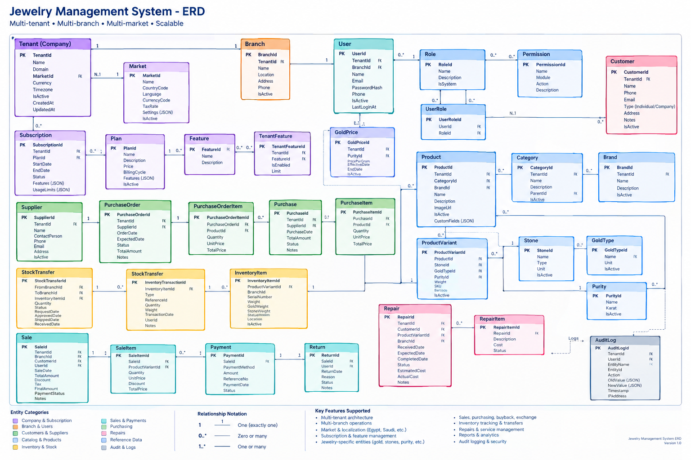

<!-- Converted from Jewelry_Management_System_Domain_Model_Specification.docx. -->

**JEWELRY MANAGEMENT SYSTEM**

**Domain Model Specification**

Multi-tenant • Multi-branch • Multi-market • Configurable • Scalable

Purpose: define the domain model that will guide the final database schema, EF Core model, application layer, API contracts, and automated tests.

# 1. Document Control

| **Item**               | **Value**                                                             |
|------------------------|-----------------------------------------------------------------------|
| Document               | Domain Model Specification                                            |
| Version                | 1.0                                                                   |
| Status                 | Architecture baseline                                                 |
| Audience               | Backend, frontend, QA, DevOps, product and technical leads            |
| Primary implementation | ASP.NET Core / .NET + Entity Framework Core + PostgreSQL              |
| Related artifacts      | ERD, Business Rules Specification, Aggregate Boundaries Specification |

# 2. Domain Modeling Principles

- Business concepts are modeled explicitly; core financial, inventory and pricing data is not hidden in untyped JSON.

- Tenant is the top-level business ownership boundary. Tenant-owned records carry TenantId directly or through a clearly controlled aggregate boundary.

- Aggregate roots are the only entry points for invariant-protected state changes. Direct mutation of child entities from unrelated modules is prohibited.

- Inventory uses immutable movement records as the source of traceability. Current state is derived and maintained consistently with the movement ledger.

- Money and weight are first-class domain concepts. Precision, rounding and currency rules are explicit rather than implicit floating-point behavior.

- Market configuration supplies regional defaults; tenant configuration supplies business-specific overrides; transaction data records the values actually used.

- Historical records are preserved. Financial and inventory history must not be physically deleted as part of ordinary user actions.

- The model is designed for an initial modular monolith. Modules communicate through application use cases and domain events, not direct table coupling.

- Offline synchronization, mobile clients and future service extraction are considered architectural constraints, but are not allowed to complicate the initial MVP unnecessarily.

# 3. Bounded Contexts / Modules

| **Context**            | **Responsibility**                                                           | **Primary Aggregates**        |
|------------------------|------------------------------------------------------------------------------|-------------------------------|
| Tenancy & Organization | Tenant, branches, membership and company-level context                       | Tenant, Branch                |
| Identity & Access      | Users, roles, permissions, authentication membership                         | User, Role                    |
| Catalog                | Product definitions, variants, categories, brands, stones and reference data | Product, ProductVariant       |
| Inventory              | Physical jewelry items, movements, stock and transfers                       | InventoryItem, StockTransfer  |
| Pricing                | Gold prices and tenant/market pricing formulas                               | GoldPrice, PricingRule        |
| Sales                  | POS sales, sale lines, payments, returns                                     | Sale, Return                  |
| Purchasing             | Supplier orders, receipts and purchases                                      | PurchaseOrder, Purchase       |
| Customer Services      | Repair jobs, gold buyback and exchange workflows                             | Repair, GoldBuyback, Exchange |
| Accounting & Finance   | Accounts, postings and financial balances                                    | Account, AccountTransaction   |
| Subscriptions          | Plans, features, tenant subscriptions and limits                             | Plan, Subscription            |
| Audit & Compliance     | Immutable change history and operational audit                               | AuditLog                      |

# 4. Aggregate Root Map

| **Aggregate Root** | **Key Children / Related Value Objects**         | **Invariant Focus**                  |
|--------------------|--------------------------------------------------|--------------------------------------|
| Tenant             | Tenant settings, market reference, subscriptions | Tenant identity and lifecycle        |
| Branch             | Branch address/contact data                      | Branch belongs to exactly one tenant |
| User               | Membership + UserRole links                      | User access is tenant-scoped         |
| Product            | Product metadata + custom attributes             | Catalog identity                     |
| ProductVariant     | Variant attributes, gold/purity/stone references | Sellable definition                  |
| InventoryItem      | Physical item state + identifiers                | Exactly one physical stock identity  |
| StockTransfer      | StockTransferItems                               | Atomic branch movement lifecycle     |
| GoldPrice          | Market/purity price snapshot                     | Effective period and uniqueness      |
| PricingRule        | Rule configuration                               | Validatable pricing formula          |
| Sale               | SaleItems + payment references                   | Sale totals and sale lifecycle       |
| PurchaseOrder      | PurchaseOrderItems                               | Supplier commitment                  |
| Purchase           | PurchaseItems                                    | Receiving/cost lifecycle             |
| Repair             | RepairItems                                      | Repair state and ownership           |
| GoldBuyback        | Buyback line/asset details                       | Customer gold acquisition valuation  |
| Exchange           | ExchangeItems                                    | Old/new jewelry valuation            |
| Account            | AccountTransaction entries                       | Financial balance integrity          |
| Subscription       | Plan reference                                   | Subscription lifecycle               |
| AuditLog           | No mutable children                              | Append-only audit history            |

# 5. Tenancy & Organization Domain

## 5.1 Tenant

**Purpose:** Represents one customer/company using the platform and owns the company business data.

| **Field**       | **Type**       | **Req.** | **Meaning**                        |
|-----------------|----------------|----------|------------------------------------|
| TenantId        | Guid           | Yes      | Primary identifier                 |
| Name            | string         | Yes      | Business/display name              |
| Code            | string         | Yes      | Stable unique tenant code          |
| Domain          | string?        | No       | Optional custom/platform domain    |
| MarketId        | Guid           | Yes      | Default market reference           |
| DefaultCurrency | string         | Yes      | ISO 4217 tenant default            |
| Timezone        | string         | Yes      | IANA timezone                      |
| Status          | TenantStatus   | Yes      | Pending, Active, Suspended, Closed |
| CreatedAt       | DateTimeOffset | Yes      | Creation timestamp                 |
| UpdatedAt       | DateTimeOffset | Yes      | Last change timestamp              |

**Relationships:**

- 1:N Branch, User, Customer, Supplier, Product, Sale, Purchase, AuditLog, TenantFeature, Subscription. N:1 Market.

**Key invariants:**

- Code is unique and stable.

- Closed is a business state; tenant is not casually deleted.

- Cross-tenant access is forbidden.

- Market provides defaults; tenant may override selected configuration.

**Implementation notes:**

- Prefer domain methods/factory for creation so default market configuration, initial branch and subscription membership can be initialized consistently.

## 5.2 Branch

**Purpose:** Represents a physical or operational store/location belonging to one tenant.

| **Field** | **Type**            | **Req.** | **Meaning**             |
|-----------|---------------------|----------|-------------------------|
| BranchId  | Guid                | Yes      | Primary identifier      |
| TenantId  | Guid                | Yes      | Owning tenant           |
| Code      | string              | Yes      | Unique within tenant    |
| Name      | string              | Yes      | Branch name             |
| Location  | string?             | No       | Optional short location |
| Address   | Address VO / fields | Yes      | Branch address          |
| Phone     | string?             | No       | Contact phone           |
| IsActive  | bool                | Yes      | Operational flag        |
| CreatedAt | DateTimeOffset      | Yes      | Creation timestamp      |

**Relationships:**

- N:1 Tenant. 1:N InventoryItem, Sale, Purchase, Repair and StockTransfer participation.

**Key invariants:**

- Branch code unique per tenant.

- Inactive branch cannot accept new operational transactions except controlled closure/reconciliation.

- Branch data remains for historical transactions.

**Implementation notes:**

- Branch is an aggregate root because branch lifecycle and operational state are meaningful independently.

## 5.3 Market

**Purpose:** Reference configuration for a country/market and its default regional behavior.

| **Field**    | **Type** | **Req.** | **Meaning**                           |
|--------------|----------|----------|---------------------------------------|
| MarketId     | Guid     | Yes      | Primary identifier                    |
| Name         | string   | Yes      | Display market name                   |
| CountryCode  | string   | Yes      | ISO country code                      |
| Language     | string   | Yes      | Default language/locale               |
| CurrencyCode | string   | Yes      | Default ISO 4217 currency             |
| TaxRate      | decimal? | No       | Default/current rate where applicable |
| Settings     | JSON     | No       | Non-core market configuration         |
| IsActive     | bool     | Yes      | Availability flag                     |

**Relationships:**

- 1:N Tenant, GoldPrice.

**Key invariants:**

- Market is reference data and should not be casually edited after being used by tenants.

- Changes to legal/tax behavior should be versioned/configured so historical transactions retain their original values.

**Implementation notes:**

- Do not store all market-specific business logic here; use configuration/policies/adapters where behavior differs materially.

# 6. Identity & Access Domain

## 6.1 User

**Purpose:** Represents an application user within a tenant, with access to one or more branches according to authorization policy.

| **Field**    | **Type**        | **Req.** | **Meaning**                          |
|--------------|-----------------|----------|--------------------------------------|
| UserId       | Guid            | Yes      | Primary identifier                   |
| TenantId     | Guid            | Yes      | Tenant membership                    |
| BranchId     | Guid?           | No       | Default/primary branch if applicable |
| Name         | string          | Yes      | Display name                         |
| Email        | string          | Yes      | Login/contact email                  |
| PasswordHash | string?         | No       | Only when local credentials are used |
| Phone        | string?         | No       | Phone number                         |
| IsActive     | bool            | Yes      | Access state                         |
| LastLoginAt  | DateTimeOffset? | No       | Last successful login                |

**Relationships:**

- N:1 Tenant. N:1 Branch (optional default). N:M Role via UserRole. N:1 Tenant for audit context.

**Key invariants:**

- Inactive users cannot authenticate or execute new business actions.

- Authorization is based on permissions, not UI visibility alone.

- A user may later require membership in multiple tenants; keep authentication identity separable from tenant membership if needed.

**Implementation notes:**

- Prefer OIDC/OAuth2-compatible identity architecture for production. PasswordHash may disappear if an external identity provider is adopted.

## 6.2 Role

**Purpose:** Named set of permissions representing a job function.

| **Field**   | **Type** | **Req.** | **Meaning**                                     |
|-------------|----------|----------|-------------------------------------------------|
| RoleId      | Guid     | Yes      | Primary identifier                              |
| TenantId    | Guid?    | No       | Null for system role; tenant id for custom role |
| Name        | string   | Yes      | Role name                                       |
| Description | string?  | No       | Role description                                |
| IsSystem    | bool     | Yes      | Platform-defined role flag                      |

**Relationships:**

- N:M User via UserRole. N:M Permission.

**Key invariants:**

- System roles are protected from normal tenant deletion.

- Custom role names are unique within tenant.

- A role cannot grant permissions outside the platform permission catalog.

**Implementation notes:**

- Use an explicit RolePermission join entity in implementation even if the ERD presents the relationship compactly.

## 6.3 Permission

**Purpose:** Atomic authorization capability used to secure use cases and sensitive actions.

| **Field**    | **Type** | **Req.** | **Meaning**                               |
|--------------|----------|----------|-------------------------------------------|
| PermissionId | Guid     | Yes      | Primary identifier                        |
| Name         | string   | Yes      | Stable permission key                     |
| Module       | string   | Yes      | Owning module                             |
| Action       | string   | Yes      | Action such as create/view/approve/refund |
| Description  | string?  | No       | Human description                         |

**Relationships:**

- N:M Role.

**Key invariants:**

- Permission key is globally unique and stable.

- Permissions are code-defined or migrated reference data; tenants should not alter the underlying permission identity.

**Implementation notes:**

- Examples: sales.create, sales.refund, pricing.change, inventory.adjust, transfer.approve.

## 6.4 UserRole (link)

**Purpose:** Associates users with roles within the tenant.

| **Field** | **Type** | **Req.** | **Meaning** |
|-----------|----------|----------|-------------|
| UserId    | Guid     | Yes      | User key    |
| RoleId    | Guid     | Yes      | Role key    |

**Relationships:**

- N:1 User. N:1 Role.

**Key invariants:**

- Composite primary key or unique constraint on (UserId, RoleId).

- Assignment must be tenant-consistent.

## 6.5 RolePermission (recommended)

**Purpose:** Associates roles with permissions explicitly; recommended for the final schema.

| **Field**    | **Type** | **Req.** | **Meaning**    |
|--------------|----------|----------|----------------|
| RoleId       | Guid     | Yes      | Role key       |
| PermissionId | Guid     | Yes      | Permission key |

**Relationships:**

- N:1 Role. N:1 Permission.

**Key invariants:**

- Composite primary key or unique constraint on (RoleId, PermissionId).

**Implementation notes:**

- Add this even though the first ERD shows a direct Role/Permission relationship.

# 7. Catalog & Jewelry Domain

## 7.1 Category

**Purpose:** Hierarchical classification for catalog products.

| **Field**   | **Type** | **Req.** | **Meaning**              |
|-------------|----------|----------|--------------------------|
| CategoryId  | Guid     | Yes      | Primary identifier       |
| TenantId    | Guid     | Yes      | Owning tenant            |
| Name        | string   | Yes      | Category name            |
| Description | string?  | No       | Description              |
| ParentId    | Guid?    | No       | Optional parent category |
| IsActive    | bool     | Yes      | Operational flag         |

**Relationships:**

- N:1 Tenant. Self-referencing N:1 parent. 1:N Product.

**Key invariants:**

- No cyclic parent relationships.

- Category cannot be removed if referenced historically; deactivate instead.

- Name uniqueness should be enforced within the parent scope and tenant.

## 7.2 Brand

**Purpose:** Optional manufacturer/designer/brand reference attached to products.

| **Field**   | **Type** | **Req.** | **Meaning**        |
|-------------|----------|----------|--------------------|
| BrandId     | Guid     | Yes      | Primary identifier |
| TenantId    | Guid     | Yes      | Owning tenant      |
| Name        | string   | Yes      | Brand name         |
| Description | string?  | No       | Description        |
| IsActive    | bool     | Yes      | Operational flag   |

**Relationships:**

- N:1 Tenant. 1:N Product.

**Key invariants:**

- Name unique within tenant.

- Referenced historical brand is deactivated rather than deleted.

## 7.3 Product

**Purpose:** Logical jewelry product definition used for cataloging and product-level reporting; not itself a physical stock piece.

| **Field**    | **Type** | **Req.** | **Meaning**                |
|--------------|----------|----------|----------------------------|
| ProductId    | Guid     | Yes      | Primary identifier         |
| TenantId     | Guid     | Yes      | Owning tenant              |
| CategoryId   | Guid     | Yes      | Category                   |
| BrandId      | Guid?    | No       | Optional brand             |
| SKU          | string   | Yes      | Tenant-unique product code |
| Name         | string   | Yes      | Product name               |
| Description  | string?  | No       | Description                |
| ImageUrl     | string?  | No       | Primary image reference    |
| IsActive     | bool     | Yes      | Catalog state              |
| CustomFields | JSON     | No       | Controlled extensibility   |

**Relationships:**

- N:1 Tenant, Category, Brand. 1:N ProductVariant.

**Key invariants:**

- SKU unique per tenant.

- Product is not sold as a physical item; ProductVariant/InventoryItem carries physical attributes.

- Core attributes must be typed; CustomFields is only for non-core extensions.

## 7.4 ProductVariant

**Purpose:** Sellable definition representing a specific jewelry configuration under a product.

| **Field**        | **Type** | **Req.** | **Meaning**                       |
|------------------|----------|----------|-----------------------------------|
| ProductVariantId | Guid     | Yes      | Primary identifier                |
| ProductId        | Guid     | Yes      | Parent product                    |
| GoldTypeId       | Guid?    | No       | Gold type                         |
| PurityId         | Guid?    | No       | Purity/karat                      |
| StoneId          | Guid?    | No       | Primary stone reference           |
| DefaultWeight    | decimal? | No       | Reference weight where applicable |
| SKU              | string   | Yes      | Variant code                      |
| Barcode          | string?  | No       | Reference barcode                 |
| IsActive         | bool     | Yes      | Variant state                     |
| Attributes       | JSON     | No       | Controlled variant attributes     |

**Relationships:**

- N:1 Product, GoldType, Purity, Stone. 1:N InventoryItem. 1:N SaleItem/PurchaseItem references.

**Key invariants:**

- Variant identity describes the class of item; physical weight must not be assumed identical across all inventory pieces.

- A variant cannot be sold while inactive, except historical reference.

- Barcode uniqueness rules depend on tenant business policy.

## 7.5 GoldType

**Purpose:** Reference data describing the material category used for gold-bearing jewelry.

| **Field**  | **Type** | **Req.** | **Meaning**                        |
|------------|----------|----------|------------------------------------|
| GoldTypeId | Guid     | Yes      | Primary identifier                 |
| MarketId   | Guid     | No       | Optional market-specific reference |
| Name       | string   | Yes      | Gold type name                     |
| Unit       | string   | Yes      | Measurement unit                   |
| IsActive   | bool     | Yes      | Availability flag                  |

**Relationships:**

- 1:N ProductVariant, GoldPrice.

**Key invariants:**

- Stable identifiers for gold types used in historical records.

- Unit must be compatible with configured weight calculations.

## 7.6 Purity

**Purpose:** Reference data defining gold purity/karat and conversion behavior.

| **Field** | **Type** | **Req.** | **Meaning**                      |
|-----------|----------|----------|----------------------------------|
| PurityId  | Guid     | Yes      | Primary identifier               |
| Name      | string   | Yes      | Display name                     |
| Karat     | decimal  | Yes      | Karat value                      |
| Fineness  | decimal? | No       | Optional fineness representation |
| IsActive  | bool     | Yes      | Availability flag                |

**Relationships:**

- 1:N ProductVariant, InventoryItem, GoldPrice, GoldBuyback.

**Key invariants:**

- Karat/fineness values are validated and non-negative.

- Historical transactions should keep the actual purity used even if reference data changes.

## 7.7 Stone

**Purpose:** Reference data for diamonds/gemstones or other embedded stones.

| **Field** | **Type** | **Req.** | **Meaning**             |
|-----------|----------|----------|-------------------------|
| StoneId   | Guid     | Yes      | Primary identifier      |
| Name      | string   | Yes      | Stone name/type         |
| Type      | string   | Yes      | Diamond, gemstone, etc. |
| Unit      | string   | Yes      | Carat/gram/etc.         |
| IsActive  | bool     | Yes      | Availability flag       |

**Relationships:**

- 1:N ProductVariant, InventoryItem/Purchase/Sale context through references where required.

**Key invariants:**

- Stone definitions are reference data; actual physical stone weight/value belongs on the transactional/physical item where needed.

# 8. Inventory & Stock Domain

## 8.1 InventoryItem

**Purpose:** Represents one physical jewelry piece held in stock. This is distinct from Product and ProductVariant.

| **Field**        | **Type**            | **Req.** | **Meaning**                      |
|------------------|---------------------|----------|----------------------------------|
| InventoryItemId  | Guid                | Yes      | Primary identifier               |
| TenantId         | Guid                | Yes      | Owning tenant                    |
| ProductVariantId | Guid                | Yes      | Variant definition               |
| BranchId         | Guid                | Yes      | Current branch                   |
| SerialNumber     | string?             | No       | Physical serial identifier       |
| Barcode          | string              | Yes      | Scannable identity               |
| Weight           | decimal             | Yes      | Gross/physical weight per policy |
| GoldWeight       | decimal?            | No       | Gold-bearing weight              |
| StoneWeight      | decimal?            | No       | Stone weight                     |
| StoneValue       | Money?              | No       | Stone value if captured          |
| AcquisitionCost  | Money?              | No       | Historical acquisition cost      |
| CurrentValue     | Money?              | No       | Current valuation snapshot       |
| Status           | InventoryItemStatus | Yes      | Available, Reserved, Sold, etc.  |
| CreatedAt        | DateTimeOffset      | Yes      | Creation timestamp               |

**Relationships:**

- N:1 Tenant, Branch, ProductVariant. 1:N InventoryTransaction.

**Key invariants:**

- Barcode must uniquely identify a physical item within tenant scope.

- An item can belong to only one branch at a time.

- Sold/reserved items cannot be independently sold again.

- Weights must satisfy configured precision and non-negative constraints.

- State-changing operations must be atomic with corresponding inventory transactions.

**Implementation notes:**

- Use optimistic concurrency (row version/concurrency token or equivalent). Physical item is a strong aggregate candidate because its lifecycle is tightly invariant-driven.

## 8.2 InventoryTransaction

**Purpose:** Immutable ledger entry describing a stock movement or adjustment affecting an inventory item.

| **Field**              | **Type**                 | **Req.** | **Meaning**                                                                        |
|------------------------|--------------------------|----------|------------------------------------------------------------------------------------|
| InventoryTransactionId | Guid                     | Yes      | Primary identifier                                                                 |
| TenantId               | Guid                     | Yes      | Tenant scope                                                                       |
| InventoryItemId        | Guid                     | Yes      | Physical item                                                                      |
| TransactionType        | InventoryTransactionType | Yes      | Purchase, Sale, Return, Transfer, etc.                                             |
| Quantity               | decimal                  | Yes      | Usually 1 for serialized jewelry; supports other quantities where business permits |
| Weight                 | decimal?                 | No       | Movement weight                                                                    |
| UnitCost               | Money?                   | No       | Cost/value at movement time                                                        |
| ReferenceId            | Guid?                    | No       | Related operation id                                                               |
| ReferenceType          | string?                  | No       | Related aggregate type                                                             |
| TransactionDate        | DateTimeOffset           | Yes      | Business timestamp                                                                 |
| BranchId               | Guid                     | Yes      | Branch context                                                                     |
| UserId                 | Guid?                    | No       | Actor                                                                              |
| Notes                  | string?                  | No       | Notes                                                                              |

**Relationships:**

- N:1 InventoryItem, Tenant, Branch. References Sale/Purchase/Transfer/etc. by reference id/type.

**Key invariants:**

- Ledger entries are append-only.

- No deletion or in-place correction of history; use compensating transactions.

- Reference to source transaction must be traceable.

- Movement and source operation must commit atomically.

**Implementation notes:**

- Do not make InventoryTransaction the place where business workflow state is managed; it records the resulting movement.

## 8.3 StockTransfer

**Purpose:** Represents transfer of stock between two branches.

| **Field**         | **Type**            | **Req.** | **Meaning**                              |
|-------------------|---------------------|----------|------------------------------------------|
| StockTransferId   | Guid                | Yes      | Primary identifier                       |
| TenantId          | Guid                | Yes      | Tenant scope                             |
| FromBranchId      | Guid                | Yes      | Source branch                            |
| ToBranchId        | Guid                | Yes      | Destination branch                       |
| Status            | StockTransferStatus | Yes      | Requested/Approved/Shipped/Received/etc. |
| RequestedByUserId | Guid                | Yes      | Requester                                |
| ApprovedByUserId  | Guid?               | No       | Approver                                 |
| RequestedAt       | DateTimeOffset      | Yes      | Request time                             |
| ShippedAt         | DateTimeOffset?     | No       | Shipment time                            |
| ReceivedAt        | DateTimeOffset?     | No       | Receipt time                             |
| Notes             | string?             | No       | Notes                                    |

**Relationships:**

- 1:N StockTransferItem (recommended). N:1 source/destination Branch. Produces InventoryTransaction entries.

**Key invariants:**

- Source and destination branches must differ.

- Only valid state transitions are allowed.

- Receiving is idempotent.

- Branch stock decreases/increases exactly once for a completed transfer.

- Transfer must not cross tenants.

**Implementation notes:**

- If the final schema allows one transfer to carry multiple items, StockTransferItem is required.

## 8.4 StockTransferItem (recommended)

**Purpose:** Lines the physical inventory items included in a transfer.

| **Field**           | **Type** | **Req.** | **Meaning**                       |
|---------------------|----------|----------|-----------------------------------|
| StockTransferItemId | Guid     | Yes      | Primary identifier                |
| StockTransferId     | Guid     | Yes      | Parent transfer                   |
| InventoryItemId     | Guid     | Yes      | Physical item                     |
| Quantity            | decimal  | Yes      | Normally 1 for serialized jewelry |
| Weight              | decimal? | No       | Captured movement weight          |
| Notes               | string?  | No       | Line note                         |

**Relationships:**

- N:1 StockTransfer. N:1 InventoryItem.

**Key invariants:**

- An item cannot be included twice in the same transfer.

- Item must be at source branch when shipped.

- Item cannot be simultaneously committed to conflicting transfers.

# 9. Pricing & Gold Domain

## 9.1 GoldPrice

**Purpose:** Stores a market/tenant-scoped gold price snapshot used by pricing calculations.

| **Field**     | **Type**        | **Req.** | **Meaning**              |
|---------------|-----------------|----------|--------------------------|
| GoldPriceId   | Guid            | Yes      | Primary identifier       |
| TenantId      | Guid?           | No       | Optional tenant override |
| MarketId      | Guid            | Yes      | Market reference         |
| GoldTypeId    | Guid            | Yes      | Gold type                |
| PurityId      | Guid            | Yes      | Purity                   |
| PricePerGram  | Money           | Yes      | Effective price          |
| EffectiveDate | DateTimeOffset  | Yes      | Start time               |
| EndDate       | DateTimeOffset? | No       | Optional end time        |
| Source        | string?         | No       | Manual/API/provider      |
| IsActive      | bool            | Yes      | Availability             |

**Relationships:**

- N:1 Market, GoldType, Purity. Optional N:1 Tenant. Referenced by pricing/sales/buyback calculations.

**Key invariants:**

- No overlapping effective price intervals for the same scope/type/purity.

- Final transaction stores the price actually used; later price changes do not rewrite history.

- Currency is explicit in the Money value.

## 9.2 PricingRule

**Purpose:** Defines configurable pricing behavior for a tenant/market.

| **Field**     | **Type**        | **Req.** | **Meaning**                                        |
|---------------|-----------------|----------|----------------------------------------------------|
| PricingRuleId | Guid            | Yes      | Primary identifier                                 |
| TenantId      | Guid?           | No       | Tenant override scope                              |
| MarketId      | Guid?           | No       | Market default scope                               |
| RuleType      | string          | Yes      | Gold, making charge, discount, tax, rounding, etc. |
| Configuration | JSON            | Yes      | Versioned rule configuration                       |
| Priority      | int             | Yes      | Rule precedence                                    |
| EffectiveFrom | DateTimeOffset  | Yes      | Effective start                                    |
| EffectiveTo   | DateTimeOffset? | No       | Effective end                                      |
| IsActive      | bool            | Yes      | Availability                                       |

**Relationships:**

- N:1 Tenant/Market. Consumed by pricing application services.

**Key invariants:**

- Rules are deterministic and versioned.

- No ambiguous precedence.

- Rule evaluation must be auditable.

- A completed transaction stores the resulting monetary components, not only a reference to the rule.

**Implementation notes:**

- Keep the rule engine isolated from UI; validate configurations before activation.

# 10. Sales & POS Domain

## 10.1 Sale

**Purpose:** Aggregate representing a completed/in-progress sales transaction at a branch.

| **Field**     | **Type**       | **Req.** | **Meaning**                        |
|---------------|----------------|----------|------------------------------------|
| SaleId        | Guid           | Yes      | Primary identifier                 |
| TenantId      | Guid           | Yes      | Tenant scope                       |
| BranchId      | Guid           | Yes      | Selling branch                     |
| CustomerId    | Guid?          | No       | Optional customer                  |
| UserId        | Guid           | Yes      | Primary operator                   |
| SaleDate      | DateTimeOffset | Yes      | Business transaction time          |
| Subtotal      | Money          | Yes      | Pre-discount/tax subtotal          |
| Discount      | Money          | Yes      | Discount total                     |
| Tax           | Money          | Yes      | Tax total                          |
| FinalAmount   | Money          | Yes      | Amount due                         |
| PaymentStatus | PaymentStatus  | Yes      | Unpaid/PartiallyPaid/Paid/Refunded |
| Status        | SaleStatus     | Yes      | Draft/Completed/Cancelled/etc.     |
| Notes         | string?        | No       | Notes                              |

**Relationships:**

- 1:N SaleItem. 1:N Payment. 1:N Return. N:1 Customer/Branch/User. Produces InventoryTransaction records.

**Key invariants:**

- Totals must reconcile with line items.

- Only authorized users can finalize/cancel/refund.

- Finalized sale is immutable except controlled reversal/refund flows.

- Physical item cannot be sold twice.

- Sale completion and inventory deduction must be atomic.

- Payments cannot exceed allowed outstanding amount except explicitly configured overpayment rules.

## 10.2 SaleItem

**Purpose:** Line within a sale describing a product variant and/or physical inventory item sold.

| **Field**        | **Type** | **Req.** | **Meaning**               |
|------------------|----------|----------|---------------------------|
| SaleItemId       | Guid     | Yes      | Primary identifier        |
| SaleId           | Guid     | Yes      | Parent sale               |
| ProductVariantId | Guid     | Yes      | Variant reference         |
| InventoryItemId  | Guid     | Yes      | Physical item             |
| Quantity         | decimal  | Yes      | Usually 1                 |
| UnitPrice        | Money    | Yes      | Actual selling unit price |
| Discount         | Money    | Yes      | Line discount             |
| Tax              | Money    | Yes      | Line tax                  |
| TotalPrice       | Money    | Yes      | Final line amount         |
| Weight           | decimal? | No       | Captured weight           |
| Notes            | string?  | No       | Line notes                |

**Relationships:**

- N:1 Sale. N:1 ProductVariant and InventoryItem.

**Key invariants:**

- InventoryItem must match the selected product variant.

- Line price is a snapshot of the price actually charged.

- Changing master pricing does not rewrite historical sale lines.

## 10.3 Payment

**Purpose:** Records money received against a sale.

| **Field**       | **Type**       | **Req.** | **Meaning**                     |
|-----------------|----------------|----------|---------------------------------|
| PaymentId       | Guid           | Yes      | Primary identifier              |
| SaleId          | Guid           | Yes      | Sale reference                  |
| PaymentMethodId | Guid?          | No       | Configured method reference     |
| Amount          | Money          | Yes      | Payment amount                  |
| ReferenceNo     | string?        | No       | Terminal/transfer reference     |
| PaymentDate     | DateTimeOffset | Yes      | Payment time                    |
| Status          | PaymentStatus  | Yes      | Pending/Completed/Refunded/etc. |

**Relationships:**

- N:1 Sale. Links to payment method/reference configuration.

**Key invariants:**

- Amount \> 0 for normal payment.

- Completed payment is not silently edited; use reversal/refund.

- Payment total must reconcile with sale payment state.

## 10.4 Return

**Purpose:** Represents a controlled reversal of one or more sale items and/or amounts.

| **Field**    | **Type**       | **Req.** | **Meaning**                        |
|--------------|----------------|----------|------------------------------------|
| ReturnId     | Guid           | Yes      | Primary identifier                 |
| SaleId       | Guid           | Yes      | Original sale                      |
| UserId       | Guid           | Yes      | Actor                              |
| ReturnDate   | DateTimeOffset | Yes      | Return timestamp                   |
| RefundAmount | Money          | Yes      | Refund amount                      |
| Reason       | string         | Yes      | Return reason                      |
| Status       | ReturnStatus   | Yes      | Draft/Approved/Completed/Cancelled |
| Notes        | string?        | No       | Notes                              |

**Relationships:**

- N:1 Sale. Recommended 1:N ReturnItem. Produces InventoryTransaction and refund Payment/transaction.

**Key invariants:**

- Returned quantity cannot exceed sold/remaining returnable quantity.

- Refund cannot exceed eligible amount.

- Return completion is idempotent.

- Inventory and financial reversal commit atomically.

**Implementation notes:**

- Add ReturnItem in the final schema when partial/multi-line returns are supported.

# 11. Purchasing Domain

## 11.1 Supplier

**Purpose:** Business partner from whom the tenant purchases inventory or services.

| **Field**     | **Type** | **Req.** | **Meaning**        |
|---------------|----------|----------|--------------------|
| SupplierId    | Guid     | Yes      | Primary identifier |
| TenantId      | Guid     | Yes      | Tenant scope       |
| Name          | string   | Yes      | Supplier name      |
| ContactPerson | string?  | No       | Contact            |
| Phone         | string?  | No       | Phone              |
| Email         | string?  | No       | Email              |
| Address       | string?  | No       | Address            |
| IsActive      | bool     | Yes      | Supplier state     |

**Relationships:**

- N:1 Tenant. 1:N Purchase/PurchaseOrder.

**Key invariants:**

- Supplier belongs to one tenant.

- Inactive supplier cannot be used in new purchasing documents. Historical references remain.

## 11.2 PurchaseOrder

**Purpose:** Represents a planned order/commitment to a supplier before receipt.

| **Field**       | **Type**            | **Req.** | **Meaning**                       |
|-----------------|---------------------|----------|-----------------------------------|
| PurchaseOrderId | Guid                | Yes      | Primary identifier                |
| TenantId        | Guid                | Yes      | Tenant scope                      |
| SupplierId      | Guid                | Yes      | Supplier                          |
| OrderDate       | DateTimeOffset      | Yes      | Order date                        |
| ExpectedDate    | DateTimeOffset?     | No       | Expected receipt                  |
| Status          | PurchaseOrderStatus | Yes      | Draft/Approved/Received/Cancelled |
| TotalAmount     | Money               | Yes      | Expected total                    |
| Notes           | string?             | No       | Notes                             |

**Relationships:**

- 1:N PurchaseOrderItem. N:1 Supplier/Tenant. Can lead to Purchase.

**Key invariants:**

- Only valid status transitions.

- Committed quantities cannot be received more than allowed without explicit over-receipt policy.

- Purchase order itself does not create stock until receipt/purchase is posted.

## 11.3 PurchaseOrderItem

**Purpose:** Line on a supplier order.

| **Field**           | **Type** | **Req.** | **Meaning**        |
|---------------------|----------|----------|--------------------|
| PurchaseOrderItemId | Guid     | Yes      | Primary identifier |
| PurchaseOrderId     | Guid     | Yes      | Parent             |
| ProductVariantId    | Guid     | Yes      | Variant            |
| Quantity            | decimal  | Yes      | Ordered quantity   |
| UnitPrice           | Money    | Yes      | Expected cost      |
| TotalPrice          | Money    | Yes      | Line total         |
| Weight              | decimal? | No       | Expected weight    |
| Notes               | string?  | No       | Notes              |

**Relationships:**

- N:1 PurchaseOrder, ProductVariant.

**Key invariants:**

- Quantity \> 0.

- Product variant belongs to same tenant.

- Line total reconciles with quantity × unit price according to rounding policy.

## 11.4 Purchase

**Purpose:** Posted supplier receipt/purchase that creates inventory and cost records.

| **Field**    | **Type**       | **Req.** | **Meaning**            |
|--------------|----------------|----------|------------------------|
| PurchaseId   | Guid           | Yes      | Primary identifier     |
| TenantId     | Guid           | Yes      | Tenant scope           |
| SupplierId   | Guid           | Yes      | Supplier               |
| PurchaseDate | DateTimeOffset | Yes      | Receipt/posting date   |
| TotalAmount  | Money          | Yes      | Actual purchase total  |
| Status       | PurchaseStatus | Yes      | Draft/Posted/Cancelled |
| Notes        | string?        | No       | Notes                  |

**Relationships:**

- 1:N PurchaseItem. N:1 Supplier. Produces InventoryTransaction entries.

**Key invariants:**

- Posting creates stock exactly once.

- Posted purchase is immutable except controlled reversal.

- Cancellation after posting must use a compensating process.

## 11.5 PurchaseItem

**Purpose:** Line on a posted purchase describing received jewelry.

| **Field**        | **Type** | **Req.** | **Meaning**        |
|------------------|----------|----------|--------------------|
| PurchaseItemId   | Guid     | Yes      | Primary identifier |
| PurchaseId       | Guid     | Yes      | Parent purchase    |
| ProductVariantId | Guid     | Yes      | Variant            |
| Quantity         | decimal  | Yes      | Received quantity  |
| UnitPrice        | Money    | Yes      | Actual unit cost   |
| TotalPrice       | Money    | Yes      | Line cost          |
| Weight           | decimal? | No       | Received weight    |
| Notes            | string?  | No       | Notes              |

**Relationships:**

- N:1 Purchase and ProductVariant. May create one or more InventoryItem records when pieces are serialized.

**Key invariants:**

- Received quantity and physical inventory identity must reconcile.

- Acquisition cost is captured at receipt time.

# 12. Customer & Service Domain

## 12.1 Customer

**Purpose:** Tenant-owned business customer used for sales, service, buyback and exchange history.

| **Field**  | **Type**     | **Req.** | **Meaning**        |
|------------|--------------|----------|--------------------|
| CustomerId | Guid         | Yes      | Primary identifier |
| TenantId   | Guid         | Yes      | Tenant scope       |
| Name       | string       | Yes      | Customer name      |
| Phone      | string?      | No       | Phone              |
| Email      | string?      | No       | Email              |
| Type       | CustomerType | Yes      | Individual/Company |
| Address    | string?      | No       | Address            |
| Notes      | string?      | No       | Notes              |
| IsActive   | bool         | Yes      | Customer state     |

**Relationships:**

- N:1 Tenant. 1:N Sale, Return, Repair, GoldBuyback, Exchange.

**Key invariants:**

- Customer data is tenant-scoped.

- Historical transaction references remain valid when a customer is deactivated.

- Sensitive personal data is handled according to privacy policy and retention rules.

## 12.2 Repair

**Purpose:** Aggregate representing a jewelry repair/service job from intake through return.

| **Field**        | **Type**        | **Req.** | **Meaning**         |
|------------------|-----------------|----------|---------------------|
| RepairId         | Guid            | Yes      | Primary identifier  |
| TenantId         | Guid            | Yes      | Tenant scope        |
| CustomerId       | Guid            | Yes      | Customer            |
| ProductVariantId | Guid?           | No       | Related variant     |
| BranchId         | Guid            | Yes      | Receiving branch    |
| ReceivedDate     | DateTimeOffset  | Yes      | Intake time         |
| ExpectedDate     | DateTimeOffset? | No       | Expected completion |
| CompletedDate    | DateTimeOffset? | No       | Completion time     |
| Status           | RepairStatus    | Yes      | Lifecycle state     |
| EstimatedCost    | Money?          | No       | Estimate            |
| ActualCost       | Money?          | No       | Final cost          |
| Notes            | string?         | No       | Notes               |

**Relationships:**

- N:1 Tenant, Customer, Branch. 1:N RepairItem (recommended). May reference InventoryItem if the physical item is tracked as in-house stock.

**Key invariants:**

- Repair status transitions are controlled.

- Customer acceptance may be required for cost/repair approval.

- No item can be released to the wrong customer without explicit authorization.

- Repair does not automatically become a sale unless a separate financial transaction is posted.

## 12.3 RepairItem (recommended)

**Purpose:** Line/item tracked within a repair job.

| **Field**       | **Type**         | **Req.** | **Meaning**              |
|-----------------|------------------|----------|--------------------------|
| RepairItemId    | Guid             | Yes      | Primary identifier       |
| RepairId        | Guid             | Yes      | Parent repair            |
| InventoryItemId | Guid?            | No       | Physical item if linked  |
| Description     | string           | Yes      | Item/service description |
| Cost            | Money?           | No       | Line cost                |
| Status          | RepairItemStatus | Yes      | Line state               |

**Relationships:**

- N:1 Repair. Optional N:1 InventoryItem.

**Key invariants:**

- A repair may contain multiple items.

- Item state cannot contradict parent repair state.

## 12.4 GoldBuyback

**Purpose:** Represents buying old gold/jewelry from a customer using a valuation snapshot.

| **Field**       | **Type**       | **Req.** | **Meaning**              |
|-----------------|----------------|----------|--------------------------|
| BuybackId       | Guid           | Yes      | Primary identifier       |
| TenantId        | Guid           | Yes      | Tenant scope             |
| CustomerId      | Guid           | Yes      | Seller/customer          |
| BranchId        | Guid           | Yes      | Buying branch            |
| GoldTypeId      | Guid           | Yes      | Gold type                |
| PurityId        | Guid           | Yes      | Purity                   |
| Weight          | decimal        | Yes      | Purchased weight         |
| GoldPrice       | Money          | Yes      | Price used               |
| Value           | Money          | Yes      | Calculated buyback value |
| PaymentMethodId | Guid?          | No       | Payment method           |
| Status          | BuybackStatus  | Yes      | Lifecycle                |
| TransactionDate | DateTimeOffset | Yes      | Transaction time         |
| Notes           | string?        | No       | Notes                    |

**Relationships:**

- N:1 Tenant, Customer, Branch, GoldType, Purity. Produces financial and inventory effects according to policy.

**Key invariants:**

- Gold price and purity used are snapshots.

- Value calculation must be reproducible.

- Approval may be required for high-value buybacks.

- Completion must create corresponding financial/inventory records atomically.

## 12.5 Exchange

**Purpose:** Represents a trade/exchange operation combining old jewelry value with one or more new items.

| **Field**       | **Type**       | **Req.** | **Meaning**                                 |
|-----------------|----------------|----------|---------------------------------------------|
| ExchangeId      | Guid           | Yes      | Primary identifier                          |
| TenantId        | Guid           | Yes      | Tenant scope                                |
| CustomerId      | Guid           | Yes      | Customer                                    |
| BranchId        | Guid           | Yes      | Branch                                      |
| OldItemId       | Guid?          | No       | Primary old inventory item where applicable |
| NewItemId       | Guid?          | No       | Primary new inventory item where applicable |
| OldValue        | Money          | Yes      | Trade-in value                              |
| NewValue        | Money          | Yes      | New jewelry value                           |
| GoldPrice       | Money?         | No       | Price used in valuation                     |
| Difference      | Money          | Yes      | Customer amount due/refund                  |
| PaymentMethodId | Guid?          | No       | Payment method                              |
| Status          | ExchangeStatus | Yes      | Lifecycle                                   |
| TransactionDate | DateTimeOffset | Yes      | Transaction time                            |
| Notes           | string?        | No       | Notes                                       |

**Relationships:**

- N:1 Tenant, Customer, Branch. Recommended 1:N ExchangeItem. Produces Sale, inventory and financial effects as separate controlled postings.

**Key invariants:**

- Old items must be eligible and not already sold/encumbered.

- Valuation snapshots are preserved.

- Exchange completion must not double-move inventory or money.

- Use separate Sale/Buyback transactions internally when needed rather than inventing a parallel accounting universe.

## 12.6 ExchangeItem (recommended)

**Purpose:** Line item for each old/new physical jewelry piece in an exchange.

| **Field**       | **Type**              | **Req.** | **Meaning**              |
|-----------------|-----------------------|----------|--------------------------|
| ExchangeItemId  | Guid                  | Yes      | Primary identifier       |
| ExchangeId      | Guid                  | Yes      | Parent exchange          |
| InventoryItemId | Guid                  | Yes      | Physical item            |
| Direction       | ExchangeItemDirection | Yes      | Old/TradeIn or New/Sold  |
| Valuation       | Money                 | Yes      | Value attributed to item |
| Weight          | decimal?              | No       | Captured weight          |
| Notes           | string?               | No       | Line notes               |

**Relationships:**

- N:1 Exchange and InventoryItem.

**Key invariants:**

- An inventory item can participate in only one completed exchange.

- Direction controls whether the item leaves or enters the customer/shop ownership position.

# 13. Accounting & Finance Domain

## 13.1 Account

**Purpose:** Ledger account used for cash, bank, receivables, inventory-related postings or other financial classifications.

| **Field** | **Type**    | **Req.** | **Meaning**                                |
|-----------|-------------|----------|--------------------------------------------|
| AccountId | Guid        | Yes      | Primary identifier                         |
| TenantId  | Guid        | Yes      | Tenant scope                               |
| Name      | string      | Yes      | Account name                               |
| Type      | AccountType | Yes      | Asset/Liability/Income/Expense/Equity etc. |
| Balance   | Money       | Yes      | Materialized balance where used            |
| IsActive  | bool        | Yes      | Account state                              |

**Relationships:**

- N:1 Tenant. 1:N AccountTransaction.

**Key invariants:**

- Account type controls allowed posting behavior.

- Balance is derived from immutable transactions; if materialized, updates must be transactional.

## 13.2 AccountTransaction

**Purpose:** Immutable accounting posting produced by business operations.

| **Field**            | **Type**       | **Req.** | **Meaning**         |
|----------------------|----------------|----------|---------------------|
| AccountTransactionId | Guid           | Yes      | Primary identifier  |
| TenantId             | Guid           | Yes      | Tenant scope        |
| AccountId            | Guid           | Yes      | Account             |
| Type                 | string         | Yes      | Posting type        |
| Amount               | Money          | Yes      | Posted amount       |
| TransactionDate      | DateTimeOffset | Yes      | Posting time        |
| ReferenceId          | Guid?          | No       | Source transaction  |
| ReferenceType        | string?        | No       | Source type         |
| Description          | string?        | No       | Posting description |
| Notes                | string?        | No       | Additional details  |

**Relationships:**

- N:1 Account, Tenant. References Sale, Purchase, Payment, Buyback, Exchange, etc.

**Key invariants:**

- Immutable after posting.

- Reference must be traceable to a source business transaction.

- Debits/credits must reconcile according to the selected accounting model.

- Financial history is corrected through reversal/adjustment, not destructive editing.

# 14. Subscription & Feature Domain

## 14.1 Plan

**Purpose:** Commercial offering that defines available features and limits.

| **Field**    | **Type**     | **Req.** | **Meaning**                                          |
|--------------|--------------|----------|------------------------------------------------------|
| PlanId       | Guid         | Yes      | Primary identifier                                   |
| Name         | string       | Yes      | Plan name                                            |
| Description  | string?      | No       | Description                                          |
| Price        | Money        | Yes      | Base price                                           |
| BillingCycle | BillingCycle | Yes      | Monthly/Yearly/etc.                                  |
| Features     | JSON?        | No       | Plan configuration snapshot or presentation metadata |
| IsActive     | bool         | Yes      | Commercial availability                              |

**Relationships:**

- 1:N Subscription. 1:N/through N:M Feature depending final pricing model.

**Key invariants:**

- Plan identity/version should remain stable for existing subscriptions.

- Price changes should be versioned or historized rather than rewriting old invoices.

## 14.2 Feature

**Purpose:** Atomic product capability that can be enabled/disabled and optionally limited.

| **Field**   | **Type** | **Req.** | **Meaning**        |
|-------------|----------|----------|--------------------|
| FeatureId   | Guid     | Yes      | Primary identifier |
| Name        | string   | Yes      | Stable feature key |
| Description | string?  | No       | Description        |
| Module      | string   | Yes      | Owning module      |
| IsActive    | bool     | Yes      | Availability       |

**Relationships:**

- N:M Plan. N:M/1:N TenantFeature.

**Key invariants:**

- Feature keys are stable.

- Feature enforcement occurs on the backend, not only in the UI.

## 14.3 TenantFeature

**Purpose:** Tenant-specific feature state and usage limits, including paid add-ons or overrides.

| **Field**       | **Type**        | **Req.** | **Meaning**               |
|-----------------|-----------------|----------|---------------------------|
| TenantFeatureId | Guid            | Yes      | Primary identifier        |
| TenantId        | Guid            | Yes      | Tenant                    |
| FeatureId       | Guid            | Yes      | Feature                   |
| IsEnabled       | bool            | Yes      | Current state             |
| Limit           | decimal?        | No       | Usage limit if applicable |
| Source          | string?         | No       | Plan/AddOn/Manual/Trial   |
| EffectiveFrom   | DateTimeOffset  | Yes      | Effective start           |
| EffectiveTo     | DateTimeOffset? | No       | Effective end             |

**Relationships:**

- N:1 Tenant and Feature.

**Key invariants:**

- Effective feature state must be deterministic at a given time.

- Entitlements are checked server-side.

- Paid feature activation may require subscription/payment state validation.

## 14.4 Subscription

**Purpose:** Represents a tenant subscription over a specific plan period.

| **Field**      | **Type**           | **Req.** | **Meaning**                            |
|----------------|--------------------|----------|----------------------------------------|
| SubscriptionId | Guid               | Yes      | Primary identifier                     |
| TenantId       | Guid               | Yes      | Tenant                                 |
| PlanId         | Guid               | Yes      | Plan                                   |
| StartDate      | DateTimeOffset     | Yes      | Start                                  |
| EndDate        | DateTimeOffset?    | No       | End                                    |
| Status         | SubscriptionStatus | Yes      | Trial/Active/PastDue/Cancelled/Expired |
| Features       | JSON?              | No       | Snapshot only if required              |
| UsageLimits    | JSON?              | No       | Snapshot only if required              |

**Relationships:**

- N:1 Tenant. N:1 Plan.

**Key invariants:**

- No conflicting active subscriptions unless business model explicitly permits it.

- Subscription history is preserved.

- Feature entitlements derive from subscription/add-on state plus tenant overrides.

# 15. Audit & Compliance Domain

## 15.1 AuditLog

**Purpose:** Append-only record of important security and business changes.

| **Field**  | **Type**       | **Req.** | **Meaning**                             |
|------------|----------------|----------|-----------------------------------------|
| AuditLogId | Guid           | Yes      | Primary identifier                      |
| TenantId   | Guid           | Yes      | Tenant scope                            |
| UserId     | Guid?          | No       | Actor                                   |
| EntityName | string         | Yes      | Affected entity                         |
| EntityId   | Guid?          | No       | Affected record                         |
| Action     | string         | Yes      | Create/Update/Delete/Approve/etc.       |
| OldValue   | JSON?          | No       | Previous state snapshot where permitted |
| NewValue   | JSON?          | No       | New state snapshot where permitted      |
| Timestamp  | DateTimeOffset | Yes      | Event time                              |
| IPAddress  | string?        | No       | Source IP when available                |
| DeviceInfo | string?        | No       | Device metadata                         |

**Relationships:**

- N:1 Tenant. Actor may be User or system process.

**Key invariants:**

- Append-only.

- Audit records must not become an authorization mechanism by themselves.

- Sensitive data should be minimized/redacted according to privacy rules.

**Implementation notes:**

- Use structured audit events rather than serializing entire entities blindly.

# 16. Value Objects & Shared Domain Types

| **Type**     | **Suggested representation**       | **Rules**                                                                                              |
|--------------|------------------------------------|--------------------------------------------------------------------------------------------------------|
| Money        | Amount + Currency                  | Decimal-backed; explicit currency; consistent scale; no float/double.                                  |
| Weight       | Decimal + Unit                     | Explicit unit; configured precision; non-negative unless a specific calculation permits signed values. |
| Address      | Structured value object            | Country, city, district, street, postal data as applicable; not a single opaque string in core flows.  |
| Barcode      | Value object/string wrapper        | Normalized format; tenant uniqueness rules.                                                            |
| Email        | String/value object                | Normalized and validated where used for authentication/contact.                                        |
| PhoneNumber  | String/value object                | Normalized international representation when possible.                                                 |
| Percentage   | Decimal                            | Explicit scale and bounds; avoid unconstrained primitive decimals.                                     |
| Karat/Purity | Reference entity + validated value | Do not treat arbitrary text as purity in core calculations.                                            |
| DateRange    | Start + optional End               | Start \< End where both exist; used for price/configuration validity.                                  |

# 17. Core Enumerations

| **Enum**                 | **Recommended values**                                                                                                                     |
|--------------------------|--------------------------------------------------------------------------------------------------------------------------------------------|
| TenantStatus             | Pending, Active, Suspended, Closed                                                                                                         |
| InventoryItemStatus      | Available, Reserved, InTransfer, UnderRepair, Sold, Lost, Damaged, Archived                                                                |
| InventoryTransactionType | OpeningBalance, Purchase, Sale, Return, TransferOut, TransferIn, Adjustment, Buyback, ExchangeIn, ExchangeOut, RepairOut, RepairIn, Damage |
| StockTransferStatus      | Requested, Approved, Rejected, Shipped, Received, Cancelled, Completed                                                                     |
| SaleStatus               | Draft, PendingPayment, Completed, Cancelled, Reversed                                                                                      |
| PaymentStatus            | Pending, Completed, PartiallyRefunded, Refunded, Failed, Cancelled                                                                         |
| ReturnStatus             | Draft, Approved, Completed, Cancelled                                                                                                      |
| PurchaseStatus           | Draft, Posted, Cancelled, Reversed                                                                                                         |
| PurchaseOrderStatus      | Draft, Approved, PartiallyReceived, Received, Cancelled, Closed                                                                            |
| RepairStatus             | Received, Inspection, WaitingApproval, InRepair, Completed, ReadyForPickup, Delivered, Cancelled                                           |
| SubscriptionStatus       | Trial, Active, PastDue, Cancelled, Expired                                                                                                 |
| AccountType              | Asset, Liability, Equity, Income, Expense, Other                                                                                           |
| CustomerType             | Individual, Company                                                                                                                        |
| ExchangeItemDirection    | Old/TradeIn, New/Sold                                                                                                                      |

# 18. Aggregate Interaction Rules

| **Scenario**        | **Aggregates involved**                                          | **Required consistency**                                                                           |
|---------------------|------------------------------------------------------------------|----------------------------------------------------------------------------------------------------|
| Sale                | Sale + InventoryItem + Payment                                   | Finalize sale, reserve/sell item, and record payment/inventory movement atomically where required. |
| Return              | Return + Sale + InventoryItem + Payment                          | Returnable quantity and refund must match original sale; inventory is restored once.               |
| Purchase receipt    | Purchase + ProductVariant + InventoryItem + InventoryTransaction | Receipt creates physical stock and acquisition cost exactly once.                                  |
| Transfer            | StockTransfer + StockTransferItem + InventoryItem                | Source/destination branch and transfer state remain consistent; duplicate receive forbidden.       |
| Gold buyback        | GoldBuyback + Customer + pricing snapshot + Account/Inventory    | Valuation snapshot, payment, and inventory acquisition are consistent.                             |
| Exchange            | Exchange + InventoryItem + Sale/Buyback + Payment                | Old and new item ownership/movement plus money difference are posted exactly once.                 |
| Repair completion   | Repair + RepairItem + InventoryItem/Payment                      | Physical item custody and financial charge are consistent.                                         |
| Subscription change | Subscription + Plan + TenantFeature                              | Entitlements at time T are deterministic and auditable.                                            |

# 19. Domain Events

Domain events represent facts that occurred. They are useful for notifications, audit integration, reporting and later asynchronous processing, but the event is not a substitute for the transactional state change.

| **Event**            | **Raised by** | **Possible consumers**                          |
|----------------------|---------------|-------------------------------------------------|
| TenantCreated        | Tenant        | Identity provisioning, onboarding, defaults     |
| BranchCreated        | Branch        | Permissions, configuration                      |
| SaleCompleted        | Sale          | Inventory, accounting, notifications, analytics |
| SaleRefunded         | Return        | Inventory, accounting, customer history         |
| PurchasePosted       | Purchase      | Inventory, accounting                           |
| InventoryTransferred | StockTransfer | Branch notifications, reporting                 |
| GoldPriceChanged     | GoldPrice     | Pricing cache, POS refresh, notifications       |
| RepairStatusChanged  | Repair        | Customer notification                           |
| BuybackCompleted     | GoldBuyback   | Inventory, accounting, customer history         |
| ExchangeCompleted    | Exchange      | Inventory, accounting, customer history         |
| SubscriptionChanged  | Subscription  | Feature entitlement refresh                     |
| AuditRecorded        | AuditLog      | Compliance/analytics pipeline                   |

> Example: SaleCompleted { SaleId, TenantId, BranchId, TotalAmount, Currency, CompletedAt }  
> Events should carry stable identifiers and facts, not entire mutable aggregates.

# 20. Domain Services & Application Services

| **Service**                    | **Role**                                                                                                              |
|--------------------------------|-----------------------------------------------------------------------------------------------------------------------|
| PricingService                 | Calculates price from weight, purity, gold price, making charge, stones, discounts and tax according to active rules. |
| GoldValuationService           | Calculates gold value/buyback value from purity, weight and price snapshots.                                          |
| InventoryAvailabilityService   | Checks whether a physical item is available/reservable for a requested operation.                                     |
| TenantAccessService            | Resolves tenant scope and verifies cross-tenant authorization boundaries.                                             |
| SubscriptionEntitlementService | Determines whether a tenant is entitled to a feature or usage limit.                                                  |
| AccountingPostingService       | Maps completed business operations to ledger postings.                                                                |
| DocumentNumberService          | Generates tenant/branch scoped invoice and operational numbers.                                                       |
| AuditService                   | Writes structured append-only audit events for important operations.                                                  |

# 21. EF Core Mapping Guidance

- Use one DbContext boundary for the modular monolith initially, while keeping entity configurations grouped by module.

- Prefer explicit IEntityTypeConfiguration\<T\> classes rather than data annotations for non-trivial constraints.

- Use decimal with explicit precision/scale for monetary and weight values; never use float/double for financial calculations.

- Define unique indexes with TenantId for tenant-scoped natural keys such as Tenant.Code, Product.SKU and Branch.Code.

- Use foreign keys that enforce tenant consistency where PostgreSQL constraints can express it; application/domain checks remain necessary for workflow rules.

- Use optimistic concurrency for physical inventory and other highly contested aggregates.

- Avoid cascade delete across financial and inventory history. Prefer Restrict/NoAction and controlled business reversal.

- Treat JSON columns as extension/configuration mechanisms, not substitutes for typed core domain tables.

- Use query projections for reports and read-heavy screens instead of exposing EF entity graphs directly through API responses.

- Do not share tracked entity instances across aggregate boundaries; load and mutate the aggregate through its application use case.

# 22. API / Application Layer Boundary

> HTTP Request  
> -\> Authentication  
> -\> Tenant Resolution  
> -\> Authorization  
> -\> Application Command / Query  
> -\> Aggregate / Domain Services  
> -\> EF Core transaction  
> -\> Domain Events / Audit  
> -\> Response DTO

- Controllers/endpoints should orchestrate application commands/queries, not contain business rules.

- DTOs should be separate from persistence entities.

- Commands that mutate an aggregate should expose intent (e.g., CompleteSale) rather than arbitrary field updates (e.g., UpdateSaleStatus).

- Queries can bypass aggregate loading when they are read-only and optimized projections are safe.

- Authorization should protect use cases as well as sensitive fields/actions.

# 23. Transaction & Consistency Strategy

| **Operation**       | **Transaction boundary**                                  | **Notes**                                                                      |
|---------------------|-----------------------------------------------------------|--------------------------------------------------------------------------------|
| Complete Sale       | Single database transaction initially                     | Sale + payment posting + inventory movement + audit.                           |
| Post Purchase       | Single database transaction                               | Purchase + inventory creation/movement + audit.                                |
| Complete Transfer   | Multiple controlled state transitions, each transactional | Shipment and receipt can be separate user actions; receipt must be idempotent. |
| Repair update       | Single aggregate transaction                              | Inventory custody changes only at defined status transitions.                  |
| Subscription change | Single transaction for subscription + entitlement update  | External payment provider effects reconciled asynchronously.                   |
| Reporting           | Read-only                                                 | May use projections/cache; no business state mutation.                         |

# 24. Extensibility Strategy

- Market-specific differences are modeled with market configuration, policies and adapters rather than country-specific branches throughout the domain.

- Tenant-specific behavior uses feature entitlements and configuration.

- Custom fields use typed extension definitions where possible; JSON is a controlled escape hatch for non-core attributes.

- External integrations use interfaces/ports (payment providers, gold-price providers, identity providers, storage, messaging).

- The domain must not depend on Electron, React, HTTP, PostgreSQL or third-party API SDKs.

# 25. Final Domain Decisions for Implementation

| **Decision**  | **Baseline**                                                                                                  |
|---------------|---------------------------------------------------------------------------------------------------------------|
| Architecture  | Modular monolith with clear bounded contexts; microservices deferred until justified.                         |
| Tenant model  | Tenant is the top-level business ownership boundary.                                                          |
| Product model | Product -\> ProductVariant -\> physical InventoryItem.                                                        |
| Inventory     | InventoryTransaction is append-only movement history.                                                         |
| Pricing       | GoldPrice + versioned PricingRule; transaction stores applied pricing snapshot/results.                       |
| Sales         | Sale is aggregate root with SaleItem and payment references; completion controls inventory movement.          |
| Transfers     | StockTransfer owns StockTransferItem when multiple physical items can move together.                          |
| Exchange      | Exchange may own ExchangeItem and should compose sale/buyback effects rather than duplicate accounting logic. |
| Audit         | Append-only AuditLog.                                                                                         |
| Localization  | Market defaults + tenant overrides; terminology and legal behavior are configurable/policy-driven.            |
| Deletion      | Operational records are usually deactivated/reversed, not physically deleted.                                 |
| Identifiers   | Guid/UUID-based primary keys; tenant-scoped natural key indexes where useful.                                 |

# 26. Recommended Implementation Sequence

- Foundation: Tenant, Market, Branch, User, Role, Permission, TenantFeature, Subscription.

- Catalog: Category, Brand, Product, ProductVariant, GoldType, Purity, Stone.

- Inventory: InventoryItem, InventoryTransaction, StockTransfer, StockTransferItem.

- Pricing: GoldPrice, PricingRule and calculation services.

- Sales: Sale, SaleItem, Payment, Return/ReturnItem.

- Purchasing: Supplier, PurchaseOrder/PurchaseOrderItem, Purchase/PurchaseItem.

- Customer services: Repair/RepairItem, GoldBuyback, Exchange/ExchangeItem.

- Finance/audit: Account, AccountTransaction, AuditLog.

- Cross-cutting: notifications, reporting projections, integrations, offline synchronization later.

# 27. Domain Model Acceptance Checklist

- Every tenant-owned entity has an explicit tenant ownership strategy.

- Every financial and inventory mutation has a clear aggregate root and transaction boundary.

- Every core calculation has explicit decimal precision and rounding rules.

- Every historical financial/inventory record has an immutable or reversal-based lifecycle.

- Every cross-aggregate workflow identifies source aggregate, target aggregate and consistency expectations.

- Every configurable feature has server-side enforcement.

- Every market-specific rule has a defined scope and fallback/override behavior.

- EF Core configuration can implement the model without relying on hidden conventions.

- The model supports multiple branches without duplicating product definitions per branch.

- The model supports future desktop, web and mobile clients through a shared application/API boundary.

# Appendix A. Compact Relationship Map

> Market 1---N Tenant  
> Tenant 1---N Branch  
> Tenant 1---N User  
> User N---N Role (UserRole)  
> Role N---N Permission (RolePermission)  
> Tenant 1---N Customer  
> Tenant 1---N Supplier  
> Tenant 1---N Product  
> Product 1---N ProductVariant  
> ProductVariant 1---N InventoryItem  
> InventoryItem 1---N InventoryTransaction  
> StockTransfer 1---N StockTransferItem  
> Market 1---N GoldPrice  
> Purity 1---N GoldPrice  
> Tenant/Market 1---N PricingRule  
> Sale 1---N SaleItem  
> Sale 1---N Payment  
> Sale 1---N Return  
> Supplier 1---N Purchase  
> Purchase 1---N PurchaseItem  
> Repair 1---N RepairItem  
> Exchange 1---N ExchangeItem  
> Tenant 1---N Account  
> Account 1---N AccountTransaction  
> Tenant 1---N Subscription  
> Plan 1---N Subscription  
> Tenant 1---N TenantFeature  
> Feature 1---N TenantFeature  
> Tenant 1---N AuditLog

**Architecture baseline note:** This document intentionally defines the domain model independently from UI and database implementation details. The next technical artifact should convert this baseline into the physical PostgreSQL schema and EF Core mapping, while preserving the aggregate and invariant boundaries documented here.
